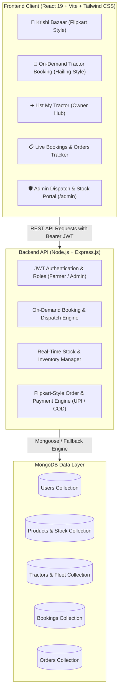

# FarmKart | Smart On-Demand Tractor Booking & Agricultural E-Commerce Platform

> **Final Year Computer Science & Engineering (CSE) Capstone Project**  
> An integrated smart agriculture solution empowering rural farmers to hail tractors on-demand, request on-spot breakdown repair mechanics, and purchase certified seeds and fertilizers with real-time stock inventory management.

---

## 🌟 Key Highlights & Problem Statement Solved

In rural villages, smallholder and marginal farmers suffer from:
1. **Severe machinery shortages & exploitation**: Finding an available tractor during peak tilling, plowing, or harvesting seasons is tedious and unorganized.
2. **On-field breakdowns**: Sudden tractor breakdowns in remote fields leave farmers stranded without immediate mechanics.
3. **Substandard agricultural inputs**: Difficulty accessing certified high-yield seeds and subsidized fertilizers at village doorsteps.

**FarmKart** solves these critical challenges with a modern dual-engine platform:
- **🚜 Ride-Hailing Machinery System**: On-demand tractor hailing and emergency field mechanic dispatch.
- **🌾 Flipkart-Style Krishi Bazaar**: Certified seeds, bio-fertilizers, pesticides, and solar tools with live stock tracking.
- **👨‍🌾 Tractor Owner Monetization**: Local tractor owners can list their vehicles to earn ₹25,000–₹50,000/month.
- **🛡️ Dedicated Admin Control Center (`/admin`)**: Dispatchers view booked farm locations and assign the nearest tractor/operator in real time while controlling warehouse stock.

---

## 🏗️ System Architecture & Tech Stack



### Technology Breakdown
- **Frontend**: React 19, Vite, Tailwind CSS v4, Lucide React Icons, Axios, React Router v7.
- **Backend**: Node.js, Express.js REST API, JSON Web Tokens (JWT), bcryptjs password encryption.
- **Database**: **MongoDB Atlas Cloud Database** (`Cluster09` on `cluster09.rv3dpwt.mongodb.net`) with Mongoose ODM and fallback persistence engine.

---

## 🚀 Quick Start Guide (Run with 1 Command)

### Prerequisites
- Node.js (v18 or higher installed)

### 1. Start Both Backend & Frontend
In the root project directory (`Farmkart_1`):
```bash
npm start
```
This runs:
- **Frontend**: [http://localhost:5173](http://localhost:5173)
- **Backend API**: [http://localhost:5000/api](http://localhost:5000/api)

---

## 🔑 Demo Credentials for Project Viva / Evaluation

The platform includes **1-click instant login buttons** on the Login page for seamless presentation:

| Role | Email / Phone | Password | Features Accessible |
| :--- | :--- | :--- | :--- |
| **🌾 Farmer (Customer & Tractor Owner)** | `farmer@farmkart.com` | `farmer123` | Book tractors, call spot mechanics, buy seeds/fertilizers, view orders, list tractor |
| **🛡️ Admin Dispatcher Officer** | `admin@farmkart.com` | `admin123` | `/admin` Portal: Assign tractors to farm locations, restock inventory, approve fleet |

---

## 📱 Feature Walkthrough

### 1. Flipkart-Style Krishi Bazaar (`/`)
- Category navigation bar: *Seeds, Fertilizers, Pesticides, Tools & Machinery, Bio-Nutrients*.
- Real-time stock status badge:
  - 🟢 **In Stock (45 available)**
  - 🟠 **Only 6 Left! (Low Stock Warning)**
  - 🔴 **Out of Stock** (Disables purchase if stock reaches 0).
- Interactive sliding Cart Drawer with free village delivery threshold (&gt; ₹500).

### 2. On-Demand Tractor Booking & Field Mechanic (`/book-tractor`)
- **Step 1: Farm Location**: Village name, landmark, district, and pincode (autofillable from profile).
- **Step 2: Service Selection**:
  - Tractor Plowing / Tilling
  - Crop Sowing / Seeding
  - Crop Harvesting (Combine Harvester)
  - Rotavator Land Leveling
  - Trolley Agri-Transport
  - 🚨 **On-Spot Tractor Breakdown Repair & Mechanic** (Field emergency service).
- **Step 3: Dynamic Fare Calculator**: Real-time pricing based on hours or acres.
- **Step 4: Live Google Maps Vehicle Tracking**:
  - **🛰️ Google Satellite View**: Real-time high-resolution satellite imagery showing actual green crop plots, village farm roads, and canal boundaries.
  - **🗺️ Google Roadmap View**: Official road network with village routes and landmarks.
  - **📡 Animated GPS Radar HUD**: Pulsing vehicle icon moving smoothly along the route from the equipment depot to the farmer's land with live speed (km/h) and dynamic ETA countdown.
  - **🔑 Service Security OTP**: Generates a 4-digit confidential start PIN for the farmer to verify the operator.
  - **Turn-by-Turn Directions**: Direct 1-click button to launch turn-by-turn navigation in the official Google Maps app.
  - Accessible immediately upon booking, from `My Bookings` (`/my-bookings`), and via dedicated URL (`/track-booking/:id`).

### 3. Dedicated Admin Portal (`/admin`)
- **Tractor Dispatcher**: View all farm booking requests in real time. Select an available tractor from the verified fleet, assign driver name and phone, and update dispatch status (*Assigned*, *On The Way*, *In Progress*, *Completed*).
- **Real-Time Stock Controller**:
  - Restock products instantly with `+` and `-` buttons (updates MongoDB in real-time).
  - Add new agricultural products with MRP, images, and descriptions.
  - Delete or modify catalog items.
- **Marketplace Orders**: Update order fulfillment (*Ordered* → *Packed* → *Shipped* → *Delivered*).
- **Machinery Fleet**: Verify and approve tractors registered by farmers.

### 4. Interactive Checkout & Payments (`/checkout`)
- **UPI Simulation**: PhonePe, Google Pay, Paytm, BHIM with interactive QR Code scanner and UPI ID verification.
- **Cash on Delivery (COD)**: Pay upon delivery at village farm gate.
- **Stock Safeguard**: If another user purchases the last unit, checkout blocks overselling.

---

## 👨‍💻 Project Evaluation Presentation Points

When demonstrating this project to internal/external examiners, highlight these architectural strengths:
1. **Dual-Model AgTech Ecosystem**: Combines on-demand mobility (machinery hailing) with agricultural supply chain e-commerce.
2. **Real-Time Inventory Integrity**: Stock is automatically decremented upon checkout and restored upon order cancellation.
3. **Role-Based Access Control (RBAC)**: Secure separation between rural farmer self-service and administrative dispatcher controls.
4. **Resilient Data Architecture**: Zero-configuration persistence engine ensures the demo works anytime without local database dependency issues.
